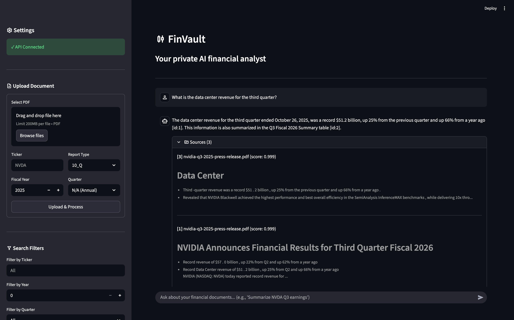

# FinVault - Private RAG for Financial Document Analysis

A **private RAG (Retrieval-Augmented Generation) system** designed for analyzing SEC filings, earnings reports, and other financial documents.

Built with [LangGraph](https://langchain-ai.github.io/langgraph/), [Supabase](https://supabase.com/), [Docling](https://github.com/DS4SD/docling), and [FlashRank](https://github.com/PrithivirajDamodaran/FlashRank), FinVault provides a complete pipeline for ingesting PDFs, chunking with contextual enrichment, hybrid retrieval, and streaming LLM responses with source citations.

## Features

- **Intelligent PDF Ingestion** – Converts PDFs to markdown with table extraction and VLM-powered image descriptions.
- **Contextual Chunking** – LLM-enriched chunks with semantic context for improved retrieval.
- **Hybrid Search** – Combines semantic (vector) and full-text search with RRF fusion.
- **HyDE Query Expansion** – Hypothetical Document Embedding for better semantic matching.
- **Cross-Encoder Reranking** – FlashRank reranker for precision at the top of results.
- **Streaming Responses** – Real-time SSE streaming with inline source citations.
- **Model Agnostic** – Supports local inference via **Ollama** and cloud inference via **Google Gemini**.

## Architecture

FinVault uses a **client-server architecture** with a Streamlit frontend, FastAPI backend, and Supabase for vector storage.

```
┌─────────────┐
│    User     │
└──────┬──────┘
       │ Chat / Upload
       ▼
┌─────────────────┐
│   Streamlit     │ (Frontend)
│   (app.py)      │
└────────┬────────┘
         │
         │ REST API / SSE
         ▼
┌─────────────────────────────────────────────────────────┐
│                    FastAPI Server                       │
│                     (server.py)                         │
├─────────────────────┬───────────────────────────────────┤
│                     │                                   │
│  ┌──────────────────▼──────────────────┐               │
│  │         Ingestion Pipeline          │               │
│  │  ┌───────────┐    ┌───────────┐     │               │
│  │  │ Converter │───▶│  Chunker  │     │               │
│  │  │ (Docling) │    │ (Enrich)  │     │               │
│  │  └───────────┘    └─────┬─────┘     │               │
│  └─────────────────────────┼───────────┘               │
│                            │                           │
│  ┌─────────────────────────▼───────────────────────┐   │
│  │              Retrieval Pipeline                 │   │
│  │  ┌────────┐   ┌─────────┐   ┌──────────────┐   │   │
│  │  │  HyDE  │──▶│ Hybrid  │──▶│   Reranker   │   │   │
│  │  │Expander│   │ Search  │   │ (FlashRank)  │   │   │
│  │  └────────┘   └─────────┘   └──────┬───────┘   │   │
│  └─────────────────────────────────────┼───────────┘   │
│                                        │               │
│  ┌─────────────────────────────────────▼───────────┐   │
│  │              LangGraph Workflow                 │   │
│  │  retrieve ──▶ rerank ──▶ generate_answer        │   │
│  └─────────────────────────────────────────────────┘   │
│                                                        │
└────────────────────────┬───────────────────────────────┘
                         │
                         ▼
              ┌──────────────────┐
              │     Supabase     │
              │  (pgvector + FTS)│
              └──────────────────┘
```

## Prerequisites

- **Python 3.13+**
- **uv** package manager
- **Ollama** installed and running (for local models)
- **Supabase** project (local or cloud)
- **Google AI Studio API Key** (optional, for Gemini)

## Install

### 1. Clone the repository

```bash
git clone https://github.com/mlexpertio/finvault-rag.git
cd finvault-rag
```

### 2. Configure Environment

Create environment files for both backend and frontend:

```bash
cp backend/.env.example backend/.env
```

Edit `backend/.env` with your credentials:

```env
SUPABASE_URL=http://localhost:54321
SUPABASE_KEY=your_supabase_anon_key

CHAT_MODEL_NAME=gemma3:4b
CHAT_MODEL_PROVIDER=ollama
OLLAMA_CONTEXT_WINDOW=32768

EMBEDDINGS_MODEL=qwen3-embedding:0.6b
RERANKER_MODEL=ms-marco-MultiBERT-L-12

# Optional: for Google Gemini
GOOGLE_API_KEY=your_google_api_key
```

### 3. Set Up Supabase

Start Supabase locally or use a cloud project:

```bash
cd supabase
supabase start
```

### 4. Install Dependencies

Install dependencies for both backend and frontend:

```bash
# Backend
cd backend
uv sync

# Frontend
cd ../frontend
uv sync
```

### 5. Pull Required Models (Ollama)

```bash
ollama pull qwen3:8b
ollama pull qwen3-embedding:0.6b
ollama pull qwen3-vl:2b  # For image descriptions
```

## Usage

### Quick Start

1. **Start the API server**:

```bash
cd backend
uv run uvicorn server:app --reload
```

2. **Launch the Streamlit app** (in a new terminal):

```bash
cd frontend
uv run streamlit run app.py
```

3. Open http://localhost:8501 in your browser.

### REST API

The server exposes a REST API at `http://localhost:8000`. Interactive docs available at `/docs`.

#### Endpoints

| Method | Endpoint | Description |
|--------|----------|-------------|
| `GET` | `/health` | Health check |
| `POST` | `/ingest` | Upload and process a PDF document |
| `GET` | `/ingest/{task_id}/status` | Check ingestion task status |
| `GET` | `/ingest/tasks` | List recent ingestion tasks |
| `POST` | `/chat` | Query the RAG system (SSE streaming) |

#### Quick Examples

```bash
# Upload a document
curl -X POST http://localhost:8000/ingest \
  -F "file=@nvidia-10q.pdf" \
  -F "ticker=NVDA" \
  -F "fiscal_year=2025" \
  -F "fiscal_quarter=3" \
  -F "report_type=10_Q"

# Chat with streaming response
curl -N -X POST http://localhost:8000/chat \
  -H "Content-Type: application/json" \
  -d '{"query": "What was NVIDIA revenue in Q3?", "ticker": "NVDA"}'
```

### Streamlit Interface

The web UI provides:

- **Document Upload** – Upload PDFs with metadata (ticker, year, quarter, report type)
- **Task Monitoring** – Track ingestion progress in real-time
- **Search Filters** – Filter by ticker, year, quarter, or report type
- **Chat Interface** – Ask questions with streaming responses and source citations
- **Conversation History** – Maintain context across multiple questions

## Configuration

### Prompts

All prompts are stored as markdown files in `backend/finvault/prompts/` for easy editing:

| Prompt | Purpose |
|--------|---------|
| `context_enrichment.md` | Generates semantic context for chunks during ingestion |
| `hyde_expansion.md` | Expands queries using Hypothetical Document Embedding |
| `multi_query_expansion.md` | Generates alternative query formulations |
| `rag_system.md` | System prompt for the financial analyst persona |
| `rag_query.md` | Template for RAG queries with context injection |
| `vlm_image_description.md` | Prompt for VLM image descriptions |

### Models

Configure models in `backend/.env`:

```env
# Local (Ollama)
CHAT_MODEL_NAME=qwen3:8b
CHAT_MODEL_PROVIDER=ollama

# Cloud (Google Gemini)
CHAT_MODEL_NAME=gemini-2.5-flash
CHAT_MODEL_PROVIDER=google_genai
```

## Repository Structure

| File / Folder | Description |
|---------------|-------------|
| `backend/server.py` | FastAPI server with ingestion and chat endpoints |
| `backend/finvault/workflow.py` | LangGraph RAG workflow (retrieve → rerank → generate) |
| `backend/finvault/ingestion/converter.py` | PDF to markdown conversion with Docling |
| `backend/finvault/ingestion/chunker.py` | Chunking, enrichment, and storage pipeline |
| `backend/finvault/retrieval/hybrid_retriever.py` | Hybrid (semantic + FTS) search with RRF |
| `backend/finvault/retrieval/hyde_expander.py` | HyDE query expansion |
| `backend/finvault/retrieval/reranker.py` | FlashRank cross-encoder reranking |
| `backend/finvault/prompts/` | Markdown prompt templates |
| `backend/finvault/prompts.py` | Prompt loader utility |
| `frontend/app.py` | Streamlit chat interface |
| `supabase/migrations/` | Database schema with pgvector and hybrid search |
| `data/` | Sample financial documents |

## Database Schema

FinVault uses Supabase with pgvector for hybrid search:

```sql
-- Documents table (stores complete markdown)
documents (id, filename, markdown_content, ticker, fiscal_year, fiscal_quarter, report_type)

-- Chunks table (stores embedded chunks)
chunks (id, document_id, content, metadata, embedding, fts)

-- Hybrid search function with RRF fusion
hybrid_search(query_text, query_embedding, match_count, filters...)
```
